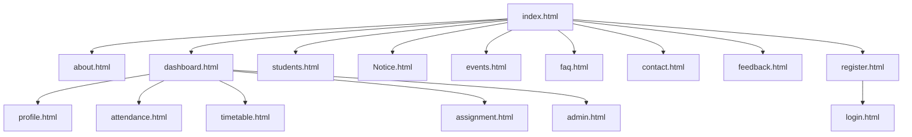
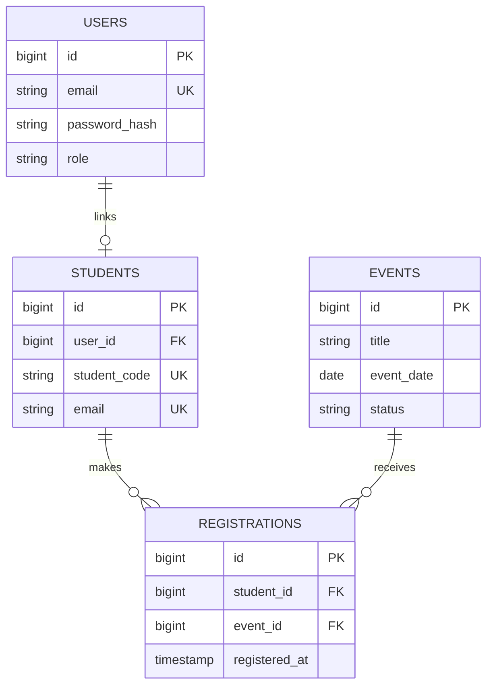

# StudentHub

StudentHub is a CHARUSAT student portal project for ITUE203 Web Development Frameworks. This project keeps the supplied StudentHub pages and campus images, and organizes the practical work into reusable styles, scripts, JSON sample data, and PHP/MySQL source.

## Project setup

1. Copy this folder into the XAMPP `htdocs` directory, for example `C:\xampp\htdocs\StudentHub`.
2. Start Apache. Open `http://localhost/StudentHub/` so JSON data is served over HTTP (the Fetch API does not work reliably from a `file://` URL).
3. The static pages, theme switch, event/FAQ JSON views, and validation work without a database.
4. Practical 7 works without MySQL. Registration and contact forms are processed by PHP and safely appended to CSV files in `php/storage/`, which Apache denies direct web access to.
5. To continue with Practicals 8–15, use PHP 8.1+ with `pdo_mysql`, `mysqli`, and file-info enabled; import `php/schema.sql` in MySQL/phpMyAdmin; and copy `php/config.local.php.example` to `php/config.local.php` with your local database credentials (or set the documented `STUDENTHUB_DB_*` Apache/PHP environment variables). If you imported an earlier version of the schema, run `php/migrations/practical-10.sql` and then `php/migrations/practical-14.sql` once. The local config file is ignored by Git. Restart Apache after changing its environment. Check the connection at `http://localhost/StudentHub/php/db-test.php`.
6. Register a user, then promote the intended administrator in phpMyAdmin with `UPDATE studenthub.users SET role='admin' WHERE email='your-email@example.com';`. Sign in again to open the role-specific portal. Never give a public account the admin role.

## Pages and sitemap



## Entity relationship model

Students and events have a many-to-many relationship through registrations. The composite unique key on each registration prevents the same student registering for the same event twice. A student can optionally be linked to a portal user account.



The shared navigation and footer connect the public pages. Academic pages include the supplied Dashboard, Profile, Attendance, Timetable, Assignments, Notices and Admin screens.

## Requirements and practical coverage

- **1 — Planning:** The sitemap is above. Supplied low-fidelity references are `images/home-wireframe.png`, `images/events-wireframe.png`, `images/login-wireframe.png` and `images/wireframe.png`. The page inventory and folder layout in this README document scope and navigation. The archive includes its Git repository; make commits as each practical is completed and connect the repository to GitHub for submission.
- **2 — Semantic HTML and access:** Fifteen linked HTML pages use page landmarks, a shared skip link, labelled forms, descriptive image text, clear heading structure, keyboard focus styling and responsive navigation.
- **3 — Responsive UI:** `CSS/theme.css` supplies shared design tokens and mobile-first rules; the existing per-page styles remain in `CSS/` and are loaded before shared overrides. Grid and Flexbox are used for card, navigation and hero layouts.
- **4 — JavaScript:** `js/theme.js` remembers light/dark theme across pages and supports the mobile menu. `js/script.js` controls the home-page slider, dismissible announcement and accessible welcome dialog. The FAQ uses native expandable details.
- **5 — Registration UX:** `register.html` and `js/register.js` validate name, email, mobile, password strength, confirmation, course, year, gender and terms with inline messages. Server validation repeats the checks.
- **6 — JSON views:** `Data/events.json`, `Data/students.json` and `Data/faqs.json` contain sample records (at least 15 each). Events, students and FAQs load with Fetch and render responsive cards. Events and students provide search, filtering, sorting and pagination; FAQs provide live search and expandable answers. Each view handles loading, empty and error states.
- **7 — PHP forms and CSV file storage:** `register.html` collects full name, email, mobile, password, confirmation, course, year, gender and terms; `php/register.php` validates these values and, when MySQL is not configured, stores profile data plus a `password_hash()` result in `php/storage/registrations.csv`. Plain-text passwords are never stored. `contact.html` posts to `php/contact.php`, which validates submissions and appends them to `php/storage/contacts.csv`. Both processors use POST/redirect/GET, trim and sanitize text, lock CSV writes, and return clear success/error messages. The storage folder is Apache-protected.
- **8 — MySQL schema and PDO connectivity:** `php/schema.sql` creates the StudentHub database and users, students, events and registrations tables with primary/foreign keys, indexes, unique constraints and sample data. The ER diagram is above. `php/db.php` opens a UTF-8 PDO MySQL connection from local configuration or environment variables; `php/db-test.php` provides a safe connection check without showing credentials or raw errors.
- **8 — PDO practice page and stored procedure:** After importing the schema, open `php/practical-8.php` to add a student or event, create a registration, list joined registrations, and call `GetStudentRegistrations` using PDO prepared statements. The procedure needs `CREATE ROUTINE` permission only for the import account, not the application account.
- **9 — Secure registration:** `js/register.js` and `php/register.php` apply matching frontend and server-side checks. With MySQL configured, the processor uses MySQLi prepared statements, checks email uniqueness, stores only the `password_hash()` result, and creates linked user/student records in one transaction with the `student` role. A duplicate email produces a clear form error. Without MySQL, Practical 7 CSV registration remains available.
- **10 — Secure login/logout and roles:** `php/login.php` verifies the stored hash, regenerates the session ID, records last login, and redirects users by role. `php/auth.php` enforces a 30-minute inactivity timeout and protects `php/dashboard.php` and `php/admin.php`; `php/logout.php` clears the session and cookie. Remember-me is optional in the practical and is not enabled.
- **11 — Student CRUD:** `php/api/students.php` provides prepared-statement create, list, update and delete operations. The administrator view supports name/email/course search, course filtering, edit and confirmed deletion, with unique student-code/email checks and clear feedback.
- **12 — Event CRUD and posters:** `php/api/events.php` creates, lists, edits and deletes events. Poster uploads verify actual MIME type, allow JPG/PNG/WebP up to 2 MB, use random server-generated filenames, and disable script execution in the upload folder.
- **13 — JSON API and Fetch:** `js/admin.js` calls the student, event and dashboard endpoints using Fetch. CRUD changes update the page without a full reload. The APIs return JSON status/error messages and check authenticated role and a session CSRF token for writes.
- **14 — Dynamic administrator dashboard:** `php/admin.php` is restricted to the `admin` role and loads live counts plus recent events from the database. Student and event management controls are available only in this protected view.
- **14 — Audit and account status:** `php/audit.php` is an administrator-only newest-first audit view. `php/api/users.php` provides the CSRF-protected active/inactive status operation for an existing user-management control; it prevents self-deactivation and deactivation of the final active administrator, and logs a successful status change transactionally.
- **15 — Integration and local submission:** Start from a fresh schema import, configure both PHP database extensions, exercise the sequence below, and capture screenshots from XAMPP for the practical submission. The project is served locally from Apache; the database and `php/storage` contents stay on the local machine.

### Practical 7–15 hand-in checks

1. Submit valid and invalid registration and contact forms; inspect the CSV headers/rows in `php/storage/` and confirm passwords appear only as hashes.
2. Load `php/db-test.php`, import the schema, and verify successful and failed login, role redirection, logout, and the 30-minute idle timeout.
3. As admin, add, search, filter, edit, and confirm deletion of a student; repeat CRUD for an event with valid and invalid poster files.
4. Use the admin page to verify Fetch updates the lists and totals without reloading; try the protected admin route with a student account and confirm access is denied.
5. Save screenshots of these outcomes and the local setup for the course submission. Do not commit local credentials, uploaded files, or private CSV data.

## Folder structure

```text
Studenthub/
├── index.html and other page HTML files
├── CSS/                 Page styles and shared theme
├── js/                  Shared and page-specific interactions
├── Data/                Public sample JSON for Fetch API views
├── images/              Supplied campus imagery and wireframes
└── php/
    ├── auth.php         Session, timeout, role and CSRF helpers
    ├── login.php        Password verification and role redirect
    ├── logout.php       Secure session teardown
    ├── dashboard.php    Protected student dashboard
    ├── admin.php        Admin dashboard and CRUD interface
    ├── api/             Student, event and dashboard JSON endpoints
    ├── uploads/events/  Validated event poster files
    ├── db.php           PDO and MySQLi connection helpers
    ├── db-test.php      Safe database connection check
    ├── register.php     Validated registration and CSV/DB storage
    ├── contact.php      Validated contact messages and CSV storage
    ├── schema.sql       MySQL schema and seed data
    ├── migrations/      Upgrade an earlier Practical 8 schema
    └── storage/         Private Practical 7 CSV output
```

## Scope note

Practicals 7–15 are implemented in sequence. Practical 7 file storage works without MySQL; Practicals 8–15 use the configured MySQL database. PHP/MySQL database integration and browser checks require an XAMPP setup with PDO MySQL, MySQLi, and file-info enabled.

## Practical 8 import, test and evidence

1. In phpMyAdmin, use **Import** and select `php/schema.sql`. It creates `studenthub` without dropping tables or data; seed rows use fictional `example.edu` addresses.
2. Copy `php/config.local.php.example` to `php/config.local.php`, then set the local MySQL values. The XAMPP default is often `127.0.0.1`, `root`, an empty password and port `3306`, but verify this locally. Keep this file uncommitted.
3. Start Apache/MySQL and open `php/db-test.php`. The success message verifies an actual PDO connection and bound health-check query. On failure, enable `pdo_mysql`, check local configuration, and inspect the server error log.
4. Open `php/practical-8.php`. Add a student and event, register that student once, submit the same pair again to verify the unique key, then call the stored-procedure form.

The schema is in 3NF: student attributes live only in `students`, event attributes only in `events`, and relationship facts only in `registrations`. The junction table resolves the many-to-many relationship. Foreign keys protect referential integrity; the `(student_id, event_id)` unique key prevents duplicates. `utf8mb4` preserves full Unicode input, and PDO prepared statements bind values separately from SQL.

### Screenshot checklist

1. phpMyAdmin tables plus the `registrations` foreign keys/indexes.
2. Mermaid ER model above.
3. Successful `php/db-test.php` check.
4. Seeded students and events.
5. Successful registration in `php/practical-8.php`.
6. Joined registration list and stored-procedure result.

### Verification report (28 October 2026)

| Test | Expected result | Actual result |
|---|---|---|
| PHP syntax check | PHP files parse | Passed for `db.php`, `db-test.php`, `practical-8.php`, and the student/event APIs using `C:\xampp\php\php.exe -l`. |
| PHP extensions | PDO MySQL available | Passed: XAMPP PHP reports `PDO`, `pdo_mysql`, and `mysqli`. |
| Safe unconfigured behavior | No internal error shown | Passed: `db-test.php` rendered its generic unconfigured message; the Practical 8 page rendered a generic unavailable message. |
| Schema import, live PDO CRUD, duplicates, and procedure | Database-backed behavior works | Not run: MySQL at `127.0.0.1:3306` was not reachable (connection error 10013). Start MySQL, import the schema, configure `config.local.php`, then follow the test steps above. |

### Viva quick answers

- **3NF:** every non-key field depends on the key, the whole key, and nothing but the key.
- **Primary/foreign keys:** a primary key identifies a row; a foreign key refers to a valid row in another table.
- **Junction table:** it models the many-to-many student/event relationship.
- **Referential integrity:** foreign keys prevent registrations for nonexistent records.
- **PDO prepared statements:** bound values cannot change the SQL syntax, preventing SQL injection.
- **`utf8mb4`:** supports full Unicode, including non-Latin text and emoji.
- **Transactions:** make multi-step changes succeed together or roll back together.
- **Unique indexes:** enforce unique email and one registration per student/event while speeding lookups.
- **Stored procedures:** reusable database operations; `GetStudentRegistrations` returns joined event information for one student.
